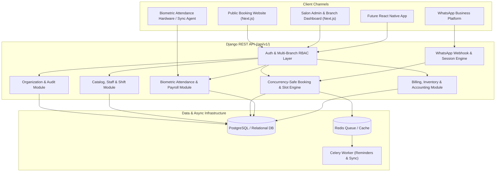

# System Architecture: Multi-Branch Salon Management System

## 1. Architectural Pattern

The system is architected as a **Modular Monolith** with a cleanly decoupled REST API backend and a modern Next.js frontend:

- **Backend (`backend/`)**: Python 3 + Django 5 + Django REST Framework (DRF) + SimpleJWT + OpenAPI (`drf-spectacular`) + Celery/Redis support.
- **Frontend (`frontend/`)**: Next.js (App Router, TypeScript, Tailwind CSS, Lucide Icons) serving both the **Public Customer Booking Portal** and the **Multi-Branch Internal Management Dashboard**.
- **Database**: PostgreSQL (primary production/Docker database) with Django ORM migrations and transactional row-level locking (`select_for_update`), plus seamless local fallback when Docker is absent.



## 2. Multi-Tenancy and Multi-Branch Isolation Strategy

1. **Tenant Isolation (`tenant_id`)**:
   - Every core business entity belongs to a `Tenant` (either directly via `tenant_id` or through its parent `Branch`).
   - Authenticated API queries automatically scope querysets to the user's `tenant_id` (unless the user is a `PLATFORM_ADMIN`).
2. **Branch Isolation (`branch_id`)**:
   - Operational records (Appointments, Branch Services, Staff Shifts, Inventory Balances, Invoices, Cash Sessions, Biometric Devices) are scoped to a `Branch`.
   - `BUSINESS_OWNER` and `PLATFORM_ADMIN` have access to all branches within their tenant.
   - `BRANCH_MANAGER`, `RECEPTIONIST`, `STAFF_MEMBER`, and branch-scoped `ACCOUNTANT` users only access branches granted via active `UserBranchRole` assignments.
   - Adding a new branch requires only a `POST /api/v1/branches/` call by the Business Owner—zero schema or code changes.

## 3. Concurrency & Double-Booking Prevention

When creating or rescheduling an appointment (via Web, Admin Walk-in, or WhatsApp):
1. The service layer opens an atomic database transaction (`transaction.atomic()`).
2. The target staff member row (`StaffProfile.objects.select_for_update()`) is locked to serialize concurrent booking requests for the same stylist/therapist.
3. Active overlapping appointments (`PENDING`, `CONFIRMED`, `CHECKED_IN`, `IN_PROGRESS`) and unexpired `BookingHold` records for that staff member are queried:
   - Overlap condition: `existing.start_time < new_end_with_buffer AND existing.end_time_with_buffer > new_start`.
4. If an overlap exists, a `409 Conflict` / validation error is raised immediately, guaranteeing zero double-bookings under concurrent load.

## 4. Directory Structure

```text
SaloonApointment/
├── backend/
│   ├── config/              # Django settings, URLs, WSGI/ASGI, Celery config
│   ├── core/                # Models, services, serializers, views, permissions, tests
│   └── manage.py
├── frontend/
│   ├── src/
│   │   ├── app/             # Next.js App Router (Public /book, Admin /dashboard, /login)
│   │   ├── components/      # Reusable UI components, modals, navigation
│   │   └── lib/             # API client, types, auth context
│   └── package.json
├── docs/                    # Architecture, Database, API, Security & Plan docs
├── docker-compose.yml       # PostgreSQL, Redis, Backend, Frontend containers
└── .env.example             # Environment variable template
```
