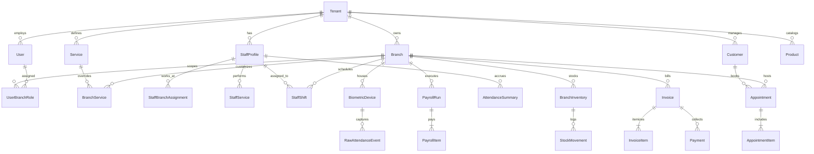

# Database Design: Multi-Branch Salon Management System

## 1. Design Principles

- **Multi-Tenant & Multi-Branch Native**: Every operational table references `tenant_id` and/or `branch_id`.
- **Auditability & Soft-Safety**: Financial records (`Invoice`, `Payment`, `Refund`, `PayrollRun`), `RawAttendanceEvent`, and `AuditLog` entries are protected against silent deletion (`PROTECT` foreign keys and status transitions instead of hard deletes).
- **Precision & Timezones**: All monetary fields use `DecimalField(max_digits=12, decimal_places=2)`. All timestamps are timezone-aware (`UTC` in storage, formatted in the branch's local timezone `Branch.timezone`).
- **Concurrency Safety**: Indexed `(staff_id, start_time, end_time)` and transactional row locks prevent overlapping bookings.

## 2. Entity-Relationship Overview

## 3. Domain Tables & Schema Specification

### 3.1 Organization & Access Control
- **`Tenant`**: `id (UUID PK)`, `name`, `slug (UNIQUE)`, `legal_name`, `email`, `phone`, `default_currency`, `default_tax_rate (Decimal)`, `is_active`, `created_at`, `updated_at`.
- **`Branch`**: `id (UUID PK)`, `tenant_id (FK -> Tenant)`, `name`, `code`, `address`, `city`, `phone`, `email`, `timezone`, `currency`, `tax_rate (Decimal)`, `cancellation_window_hours`, `buffer_minutes`, `is_active`, `created_at`, `updated_at`. Unique `(tenant_id, code)`.
- **`User`**: Custom AbstractUser with `id (UUID PK)`, `tenant_id (FK -> Tenant, nullable for platform admin)`, `email (UNIQUE)`, `full_name`, `phone`, `system_role (PLATFORM_ADMIN | BUSINESS_OWNER | STAFF | CUSTOMER)`, `is_active`.
- **`UserBranchRole`**: `id (UUID PK)`, `user_id (FK -> User)`, `branch_id (FK -> Branch)`, `role (BRANCH_MANAGER | RECEPTIONIST | STAFF_MEMBER | ACCOUNTANT)`, `is_active`, `created_at`. Unique `(user_id, branch_id, role)`.
- **`AuditLog`**: `id (UUID PK)`, `tenant_id (FK)`, `branch_id (FK, nullable)`, `actor_id (FK -> User, nullable)`, `entity_type`, `entity_id`, `action`, `metadata (JSON)`, `ip_address`, `created_at`.

### 3.2 Staff, Services & Scheduling
- **`Service`**: `id (UUID PK)`, `tenant_id (FK)`, `name`, `category`, `description`, `default_duration_minutes`, `buffer_minutes`, `base_price (Decimal)`, `is_active`, `public_bookable`.
- **`BranchService`**: `id (UUID PK)`, `branch_id (FK)`, `service_id (FK)`, `price (Decimal)`, `duration_minutes`, `buffer_minutes`, `is_available`. Unique `(branch_id, service_id)`.
- **`StaffProfile`**: `id (UUID PK)`, `tenant_id (FK)`, `user_id (OneToOne -> User, nullable)`, `employee_code`, `full_name`, `email`, `phone`, `title`, `bio`, `biometric_user_id`, `is_active`, `joined_date`. Unique `(tenant_id, employee_code)`.
- **`StaffBranchAssignment`**: `id (UUID PK)`, `staff_id (FK)`, `branch_id (FK)`, `is_primary`, `is_active`. Unique `(staff_id, branch_id)`.
- **`StaffService`**: `id (UUID PK)`, `staff_id (FK)`, `service_id (FK)`, `custom_duration_minutes (nullable)`, `is_active`. Unique `(staff_id, service_id)`.
- **`OperatingHours`**: `id (UUID PK)`, `branch_id (FK)`, `weekday (0=Mon..6=Sun)`, `open_time`, `close_time`, `is_closed`. Unique `(branch_id, weekday)`.
- **`StaffShift`**: `id (UUID PK)`, `branch_id (FK)`, `staff_id (FK)`, `weekday (0..6)`, `start_time`, `end_time`, `break_start (nullable)`, `break_end (nullable)`, `is_active`.
- **`StaffTimeOff`**: `id (UUID PK)`, `staff_id (FK)`, `branch_id (FK, nullable)`, `start_datetime`, `end_datetime`, `reason`, `status (PENDING | APPROVED | REJECTED)`.

### 3.3 Customers & Appointments
- **`Customer`**: `id (UUID PK)`, `tenant_id (FK)`, `user_id (FK, nullable)`, `full_name`, `phone`, `email`, `notes`, `whatsapp_opt_in (bool)`, `sms_opt_in (bool)`, `email_opt_in (bool)`, `consent_updated_at`, `created_at`. Unique `(tenant_id, phone)`.
- **`Appointment`**: `id (UUID PK)`, `tenant_id (FK)`, `branch_id (FK)`, `customer_id (FK)`, `primary_staff_id (FK -> StaffProfile)`, `booking_reference (UNIQUE)`, `source (WEBSITE | WHATSAPP | WALK_IN | ADMIN | PHONE)`, `status (PENDING | CONFIRMED | CHECKED_IN | IN_PROGRESS | COMPLETED | CANCELLED | NO_SHOW)`, `start_time (DateTime)`, `end_time (DateTime)`, `buffer_minutes`, `total_duration_minutes`, `subtotal_amount (Decimal)`, `tax_amount (Decimal)`, `total_amount (Decimal)`, `notes`, `cancellation_reason`, `created_by_id (FK)`, `created_at`, `updated_at`.
- **`AppointmentItem`**: `id (UUID PK)`, `appointment_id (FK)`, `service_id (FK)`, `staff_id (FK)`, `service_name_snapshot`, `duration_minutes`, `price (Decimal)`, `sequence_order`.
- **`AppointmentStatusHistory`**: `id (UUID PK)`, `appointment_id (FK)`, `from_status`, `to_status`, `changed_by_id (FK, nullable)`, `reason`, `created_at`.
- **`BookingHold`**: `id (UUID PK)`, `branch_id (FK)`, `staff_id (FK)`, `start_time`, `end_time`, `session_key`, `expires_at`, `is_released`.

### 3.4 Biometric Attendance & Payroll
- **`BiometricDevice`**: `id (UUID PK)`, `tenant_id (FK)`, `branch_id (FK)`, `name`, `serial_number (UNIQUE)`, `device_model`, `api_token`, `is_active`, `last_sync_at`, `status`.
- **`DeviceSyncRun`**: `id (UUID PK)`, `device_id (FK)`, `started_at`, `completed_at`, `events_received`, `events_imported`, `events_duplicated`, `status`, `error_message`.
- **`RawAttendanceEvent`**: `id (UUID PK)`, `tenant_id (FK)`, `branch_id (FK)`, `device_id (FK, nullable)`, `staff_id (FK, nullable)`, `biometric_user_id`, `event_type (CHECK_IN | CHECK_OUT | BREAK_OUT | BREAK_IN | UNKNOWN)`, `timestamp`, `external_event_id`, `dedup_hash (UNIQUE)`, `raw_payload (JSON)`, `created_at`.
- **`AttendanceSummary`**: `id (UUID PK)`, `branch_id (FK)`, `staff_id (FK)`, `work_date (Date)`, `first_check_in`, `last_check_out`, `worked_minutes`, `late_minutes`, `overtime_minutes`, `status (PRESENT | ABSENT | LATE | LEAVE | INCOMPLETE)`. Unique `(branch_id, staff_id, work_date)`.
- **`AttendanceAdjustment`**: `id (UUID PK)`, `summary_id (FK)`, `requested_by_id (FK)`, `approved_by_id (FK, nullable)`, `adjusted_check_in`, `adjusted_check_out`, `reason`, `status (PENDING | APPROVED | REJECTED)`, `created_at`.
- **`SalaryRule`**: `id (UUID PK)`, `staff_id (OneToOne -> StaffProfile)`, `base_monthly_salary (Decimal)`, `hourly_rate (Decimal)`, `overtime_multiplier (Decimal)`, `late_deduction_per_minute (Decimal)`.
- **`CommissionRule`**: `id (UUID PK)`, `tenant_id (FK)`, `staff_id (FK, nullable)`, `service_id (FK, nullable)`, `commission_type (PERCENTAGE | FIXED)`, `value (Decimal)`, `is_active`.
- **`PayrollRun`**: `id (UUID PK)`, `tenant_id (FK)`, `branch_id (FK)`, `period_start (Date)`, `period_end (Date)`, `status (DRAFT | APPROVED | FINALIZED)`, `total_gross (Decimal)`, `total_deductions (Decimal)`, `total_commissions (Decimal)`, `total_net (Decimal)`, `processed_by_id (FK)`, `finalized_at`.
- **`PayrollItem`**: `id (UUID PK)`, `payroll_run_id (FK)`, `staff_id (FK)`, `base_pay (Decimal)`, `commission_pay (Decimal)`, `overtime_pay (Decimal)`, `bonuses (Decimal)`, `deductions (Decimal)`, `net_pay (Decimal)`, `days_worked`, `notes`.

### 3.5 Inventory, Billing & Finance
- **`Product`**: `id (UUID PK)`, `tenant_id (FK)`, `sku`, `name`, `category (RETAIL | CONSUMABLE)`, `unit`, `cost_price (Decimal)`, `selling_price (Decimal)`, `reorder_level (Decimal)`, `is_active`. Unique `(tenant_id, sku)`.
- **`BranchInventory`**: `id (UUID PK)`, `branch_id (FK)`, `product_id (FK)`, `quantity_on_hand (Decimal)`, `reorder_level_override (Decimal, nullable)`, `updated_at`. Unique `(branch_id, product_id)`.
- **`StockMovement`**: `id (UUID PK)`, `branch_inventory_id (FK)`, `movement_type (PURCHASE | SALE | CONSUMPTION | ADJUSTMENT | TRANSFER_IN | TRANSFER_OUT)`, `quantity_delta (Decimal)`, `balance_after (Decimal)`, `reference_id`, `notes`, `performed_by_id (FK)`, `created_at`.
- **`Supplier`**: `id (UUID PK)`, `tenant_id (FK)`, `name`, `contact_person`, `phone`, `email`, `is_active`.
- **`PurchaseOrder`**: `id (UUID PK)`, `branch_id (FK)`, `supplier_id (FK)`, `po_number`, `status (DRAFT | ORDERED | RECEIVED | CANCELLED)`, `total_amount (Decimal)`, `created_at`.
- **`Invoice`**: `id (UUID PK)`, `tenant_id (FK)`, `branch_id (FK)`, `customer_id (FK, nullable)`, `appointment_id (OneToOne, nullable)`, `invoice_number (UNIQUE)`, `status (DRAFT | ISSUED | PARTIALLY_PAID | PAID | REFUNDED | VOID)`, `subtotal (Decimal)`, `discount_amount (Decimal)`, `tax_amount (Decimal)`, `total_amount (Decimal)`, `amount_paid (Decimal)`, `issued_by_id (FK)`, `created_at`.
- **`InvoiceItem`**: `id (UUID PK)`, `invoice_id (FK)`, `item_type (SERVICE | PRODUCT)`, `service_id (FK, nullable)`, `product_id (FK, nullable)`, `staff_id (FK, nullable)`, `description`, `quantity (Decimal)`, `unit_price (Decimal)`, `total_price (Decimal)`.
- **`Payment`**: `id (UUID PK)`, `invoice_id (FK)`, `branch_id (FK)`, `method (CASH | CARD | BANK_TRANSFER | WALLET | ONLINE)`, `amount (Decimal)`, `reference_code`, `received_by_id (FK)`, `created_at`.
- **`Refund`**: `id (UUID PK)`, `payment_id (FK)`, `invoice_id (FK)`, `amount (Decimal)`, `reason`, `approved_by_id (FK)`, `created_at`.
- **`Expense`**: `id (UUID PK)`, `branch_id (FK)`, `category`, `description`, `amount (Decimal)`, `incurred_date (Date)`, `recorded_by_id (FK)`, `created_at`.
- **`CashRegisterSession`**: `id (UUID PK)`, `branch_id (FK)`, `opened_by_id (FK)`, `closed_by_id (FK, nullable)`, `opening_balance (Decimal)`, `closing_balance_counted (Decimal, nullable)`, `expected_balance (Decimal)`, `status (OPEN | CLOSED)`, `opened_at`, `closed_at`.

### 3.6 Messaging & Integrations
- **`NotificationTemplate`**: `id (UUID PK)`, `tenant_id (FK)`, `code`, `channel (WHATSAPP | SMS | EMAIL)`, `body_template`, `is_active`.
- **`MessageLog`**: `id (UUID PK)`, `tenant_id (FK)`, `branch_id (FK, nullable)`, `customer_id (FK, nullable)`, `appointment_id (FK, nullable)`, `channel`, `direction (INBOUND | OUTBOUND)`, `recipient_phone`, `content`, `provider_message_id`, `status (QUEUED | SENT | DELIVERED | FAILED | RECEIVED)`, `created_at`.
- **`WebhookEvent`**: `id (UUID PK)`, `provider (WHATSAPP | PAYMENT | BIOMETRIC)`, `event_id (UNIQUE)`, `payload (JSON)`, `status (PROCESSED | IGNORED | FAILED)`, `error_message`, `created_at`.
- **`WhatsAppSession`**: `id (UUID PK)`, `tenant_id (FK)`, `phone_number`, `state (GREETING | SELECT_BRANCH | SELECT_SERVICE | SELECT_STAFF | SELECT_DATE | SELECT_SLOT | CONFIRM | COMPLETED)`, `context_data (JSON)`, `last_interaction_at`.
