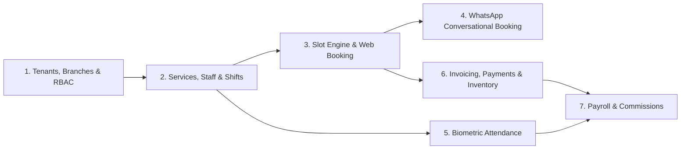

# Implementation Plan & Milestones: Multi-Branch Salon Management System

## 1. Execution Strategy

We follow an incremental, test-verified approach starting with the core multi-tenant/multi-branch foundation and concurrency-safe booking MVP, while building out the unified schema and integration layers for WhatsApp, biometric attendance, payroll, inventory, and billing.

## 2. Milestones & Checklist

### Milestone 1: Foundation, Multi-Branch Architecture & Booking MVP (Current Session)
- [x] **Step 1: Repository Inspection**: Checked directory state, Git, Python 3.14, Node 24.15, and environment capabilities.
- [x] **Step 2: Documentation Suite**:
  - `docs/PROJECT_REQUIREMENTS.md`
  - `docs/ARCHITECTURE.md`
  - `docs/DATABASE_DESIGN.md`
  - `docs/IMPLEMENTATION_PLAN.md`
  - `docs/API_DESIGN.md`
  - `docs/SECURITY.md`
- [x] **Step 3: Environment & Configuration**:
  - Create `.gitignore`, `.env.example`, `docker-compose.yml`, and `README.md`.
  - Initialize Django backend (`backend/`) and Next.js TypeScript Tailwind frontend (`frontend/`).
- [x] **Step 4: Multi-Tenant & Multi-Branch Domain Models, Auth & RBAC**:
  - Implement all domain models in `core/models.py` (Organization, RBAC, Services, Staff, Shifts, Customers, Appointments, Biometric Attendance, Payroll, Inventory, Invoicing/Finance, WhatsApp/Messaging).
  - Run `makemigrations` and `migrate`.
  - Implement custom JWT authentication and server-enforced branch/role permission classes.
  - Create seed command (`python manage.py seed_demo`) populating a realistic multi-branch salon business ("Luxe Aura Salon & Spa" with Flagship Downtown Branch & Uptown Studio Branch), role accounts, services, staff shifts, appointments, inventory, invoices, and biometric devices.
- [x] **Step 5: Scheduling, Availability, Booking Engine & Extended Modules**:
  - Implement slot availability calculator respecting branch operating hours, staff shifts, breaks, approved time-off, service duration + buffer, and existing appointments/holds.
  - Implement concurrency-safe appointment booking (`select_for_update`), rescheduling, cancellation, walk-in creation, and status history tracking.
  - Implement WhatsApp conversational webhook & state machine + idempotent webhook logging.
  - Implement provider-neutral Biometric Attendance ingestion, deduplication, and adjustment workflows.
  - Implement Billing (Invoices, Split Payments, Refunds, Expenses, Cash Sessions), Inventory (Stock Ledger), and Payroll/Commission calculation endpoints.
- [x] **Step 6: Responsive Frontend Application (Next.js + TypeScript + Tailwind)**:
  - **Public Customer Booking Portal (`/book`)**: Step-by-step interactive booking (Branch -> Services -> Staff -> Date/Time Slot -> Customer Details & Consent -> Confirmation + Lookup/Cancel/Reschedule).
  - **Internal Multi-Branch Management Dashboard (`/dashboard`)**:
    - Global Branch Switcher ("All Branches" consolidated owner view vs individual branch view).
    - Real-time KPI summary cards, revenue & appointment analytics, and staff availability status.
    - Appointment Calendar & Filterable List View with Walk-In creation, status transitions, rescheduling, and cancellation modals.
    - Services & Pricing Manager (including branch overrides).
    - Staff & Shifts Directory.
    - Biometric Attendance & Payroll Panel (sync simulator, raw events, summaries, payroll generator).
    - Inventory & Billing/POS Panel (stock ledger, invoice creation, split payments, daily sales).
    - WhatsApp Booking Simulator Panel (test end-to-end conversational booking directly against the backend webhook).
- [x] **Step 7: Automated Tests & Build Verification**:
  - Run comprehensive backend test suite (`python manage.py test`) covering:
    1. Authentication & role-based permissions.
    2. Tenant & branch isolation.
    3. Branch-specific service pricing & availability.
    4. Slot calculation & overlap prevention under concurrent booking requests.
    5. Appointment cancellation & rescheduling.
    6. WhatsApp webhook idempotency & conversational booking flow.
    7. Biometric attendance event deduplication.
    8. Payroll & commission calculation.
    9. Inventory stock movement ledger reconciliation.
    10. Invoice, split payment, and refund math.
  - Run frontend TypeScript check and production build (`npm run build`).

## 3. Dependencies Between Modules

